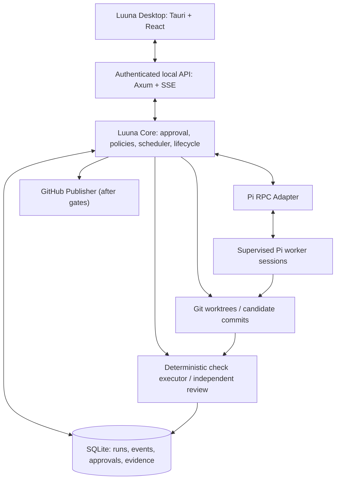
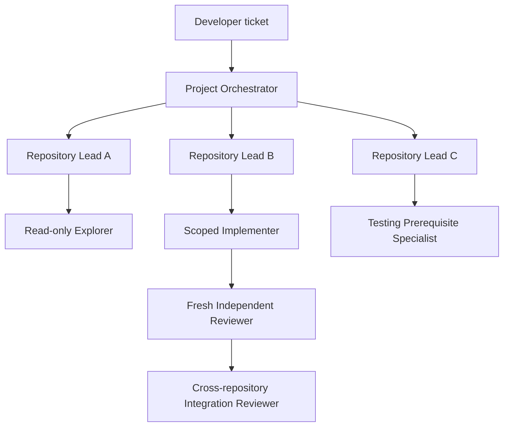
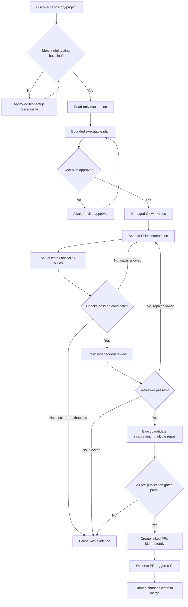

# Luuna — Complete Desktop Development Proposal and Implementation Roadmap

**Document version:** 0.2  
**Prepared:** October 16, 2026  
**Status:** Proposed architecture and implementation plan — **not an implemented or tested product**  
**Product:** Luuna, a local-first agentic software engineering workbench  
**Primary delivery:** Tauri desktop application + independent Rust orchestration service + supervised Pi RPC workers

---

## 1. Executive decision

**Build Luuna as a local-first, desktop-centered agentic software engineering workbench powered by Pi RPC and governed by a separate Rust orchestration runtime.**

Do **not** fork and strip OpenCode for the initial implementation. Do **not** build a new model/tool execution loop. Do **not** devote the first development phase to a polished visual mockup without a functioning backend.

Luuna's differentiator is not its chat interface. It is a **trustworthy, coordinated development workflow** for one developer working across related codebases: repository discovery, explicit plans, human approval, bounded agents, isolated changes, real validation, independent review, evidence, and linked pull requests.

### Recommended technology stack

| Responsibility | Recommended technology | Reason |
|---|---|---|
| Desktop application | **Tauri 2** | Cross-platform desktop shell with Rust integration |
| Desktop/browser frontend | **React + TypeScript + Vite** | Reusable web UI and strong ecosystem |
| UI styling and primitives | **Tailwind CSS + accessible headless primitives (for example Radix UI)** | Fast, consistent, keyboard-accessible interfaces |
| Local orchestration service | **Rust + Tokio + Axum** | Deterministic policy, structured concurrency, authenticated local API |
| Agent runtime | **Pinned Pi RPC subprocesses** | Reuse a genuine coding-agent engine without implementing the agent loop |
| Runtime persistence | **SQLite + schema migrations** | Transactional, durable local run state and evidence metadata |
| Code isolation | **Git branches and worktrees** | Preserve developer checkouts and separate candidate changes |
| Deterministic validation | **Existing repository test/build/lint tools** | Evidence independent of model claims |
| Code publication | **GitHub API or tested GitHub CLI integration** | Linked PR creation, recovery, and CI tracking |
| Optional telemetry | **Langfuse or similar** | Trace and evaluation visibility after core execution works |
| Optional later execution | **Container and remote workers** | Stronger execution isolation or additional host capabilities |

**Architectural alternative:** If reliable Pi RPC supervision in Rust proves disproportionately difficult, assess a small TypeScript Pi SDK host behind the same Luuna engine contract. This would require an explicit architecture decision, not an ad-hoc second backend.

### The product promise

A developer imports or creates a project, describes a desired change, receives a verified repository-aware plan, approves the exact executable scope, watches bounded coding agents implement it, and receives real check results, an independent review, and reviewable code changes. Eventually Luuna creates linked PRs while **the developer alone controls merging**.

A successful agent response is **not** proof that testing succeeded. A passing repository test is **not** proof that cross-repository integration succeeded. PR creation is **not** the same as integration.

### Relationship to the prior Luuna design

This document revises the delivery architecture and schedule of the existing Luuna design baseline. It preserves the original functional intentions and safety guarantees. Desktop-first is a **sequencing decision**; browser/TUI parity, multi-repository coordination, and supported stack profiles remain obligations for **full v1**, not claims about the internship MVP.

Primary baseline: `AI-START-HERE.md`, `LUUNA-COMPLETE-REFERENCE.md`, `02-requirements.md`, `03-architecture.md`, `04-orchestration.md`, `05-pi-integration.md`, `07-contracts.md`, `08-validation.md`, `09-experience.md`, `10-roadmap.md`, and `11-acceptance.md` from the Luuna source pack.

---

## 2. Objectives, audience, and release boundaries

### Audience

The initial product serves individual developers, especially those maintaining several connected repositories such as a frontend, shared library, backend service, and administrative application.

The core local product must not depend on a NAS, dedicated GPU, hosted platform, or Luuna-specific cloud account. The developer will still need configured model-provider access or a compatible available model to run Pi workers.

### What users should be able to do

1. Install Luuna locally and configure a supported Pi/model profile.
2. Import an existing repository, later import multiple independent repositories into one project, or create a new project.
3. Inspect confirmed repository identities, interfaces, testing prerequisites, and toolchains.
4. Write a ticket with intended behavior and measurable acceptance criteria.
5. Explore code with read-only agents and prepare a bounded executable plan.
6. Review the exact plan, permissions, candidate base commits, checks, and budgets; explicitly approve it.
7. Let agents implement scoped tasks in Luuna-owned worktrees.
8. Run actual tests, static analysis, build commands, conventions checks, and independent review.
9. See findings, logs, diffs, usage, attempts, and blockers in the desktop interface.
10. Publish linked GitHub PRs after pre-publication gates and retain human control of merging.
11. Cancel, recover, and resume safely without claiming incomplete work has passed.

### Functional scope table

| Capability | Internship MVP | Full Luuna v1 |
|---|---|---|
| Tauri desktop window | Required | Required |
| Real Pi worker and streamed output | Required | Required |
| Durable sessions and run history | Required | Required |
| Existing single-repository import | Required | Required |
| Test baseline prerequisite | Required | Required |
| Immutable exact-plan approval | Required | Required |
| Isolated Git worktrees | Required | Required |
| Bounded feature implementation | Required | Required |
| Real test/analysis evidence | Required | Required |
| Fresh independent review | Required | Required |
| Cancellation and bounded repair | Required | Required |
| Safe interruption/restart reconciliation | Required | Required |
| Multiple linked repositories | Stretch demonstration | Required |
| Project orchestrator, leads, scoped specialists | Basic/simplified planner | Required |
| Automatic linked PR creation | Stretch | Required |
| Browser and TUI capability parity | Deferred | Required |
| Guided new-project creation | Deferred | Required |
| Profiles: React, Next.js, TypeScript, Go, Node, Python, Flutter, native iOS/Android | Selected fixture only | Required |
| Personal/project/process memory controls | Deferred or minimal | Required |
| Mulch, Canopy, Seeds adapters | Deferred | Required |
| Remote NAS/Mac workers | Deferred | Post-v1 |
| GPU local inference, embeddings | Deferred | Optional later |
| Full IDE replacement, arbitrary recursive agent spawning, automatic merge | Excluded | Excluded |

**Release terminology:** A passing single-repository demo can be called the **internship MVP**, but not a completed full v1. Full v1 requires evidence against the original requirements and acceptance matrix.

---

## 3. Top-level architecture

The desktop UI, authoritative orchestration service, and individual agent sessions are distinct layers. Only the service may determine whether an action is permitted or a gate has passed.



### 3.1 Desktop application

The desktop application is a control plane, not the authority for approvals or validation. It shows projects, repository relationships, tasks, plans, workers, logs, changes, review results, settings, and history. It submits actions through the local authenticated API and receives authoritative events.

Build with Tauri 2, React, TypeScript, Vite, Tailwind, and accessible component primitives. Preserve a keyboard-first design. A browser client can reuse the same frontend features and API client later; the desktop should not hard-code business rules in Tauri commands.

### 3.2 Independent local service

The Rust service uses Tokio for process supervision and scheduling, Axum for the API, and SQLite for durable state. It owns:

- project registry and stable repository identities;
- immutable approved plans, state transitions, permission and budget enforcement;
- task DAG scheduling, locks, retries, and worktree ownership;
- Pi subprocess lifecycle and tool profile selection;
- actual command execution and validation records;
- separate reviewer sessions and findings;
- artifact storage, event streaming, reconciliation, and PR publication.

**Critical lifecycle rule:** Closing the desktop window must **not** silently kill a service-owned run. A sidecar can bootstrap the service, but sidecar launch by itself does not establish independent process lifetime. Define separate service startup, supervision, reconnection, and shutdown behavior. For the earliest development environment, the service may be run manually; a tested host-specific service strategy is needed for distribution.

### 3.3 Pi RPC adapter

Use a pinned release of Pi, with each worker having a defined role, model, working directory, resource set, tool permissions, and session/transcript references. Treat Pi as the coding-agent **engine**, not the authoritative Luuna scheduler.

Define an implementation-neutral engine boundary:

```text
create_session
submit_assignment
send_followup
request_stop
inspect_session
subscribe_events
dispose_session
```

Pi RPC uses newline-delimited JSON over subprocess stdin/stdout. Correlate command IDs; do not confuse a prompt acceptance response with agent completion. Treat stderr as diagnostics, not protocol data. Normalize agent events into the Luuna event model while maintaining raw artifacts where appropriate.

A compatibility suite must prove:

- real provider/session creation and model selection;
- event streaming and correctly detected settlement;
- prompt acceptance versus actual completion;
- permitted file/tool operations in an isolated fixture;
- cancellation, timeouts, and owned child-process termination;
- unexpected exits and provider failures;
- malformed and unknown records;
- supported extension UI interactions where relevant;
- persisted session reopening and runtime restart reconciliation.

Use fixtures for deterministic protocol/unit tests, but **never call a mock session proof of Pi integration**.

### 3.4 Persistence

Use SQLite on the runtime machine's local filesystem with versioned migrations and consistent backups. Keep bulky logs and transcripts as private artifacts with database references.

Suggested tables:

| Table | Responsibility |
|---|---|
| `projects` | Project identity and manifest revisions |
| `repositories` | Repo identities, remotes, paths, stack profiles |
| `tickets` | Requested outcome, criteria, dependencies |
| `plan_revisions` | Immutable executable plans, fingerprints, hashes |
| `approvals` | Exact plan authorization and permissions |
| `tasks` | Bounded tasks and dependency graph |
| `assignments` | Worker role, repository, model, context, tools |
| `sessions` | Pi session ownership, lifecycle, transcript ref |
| `attempts` | Retries, failures, aggregate budgets |
| `worktrees` | Git worktree ownership/lock state |
| `candidate_sets` | Commit/tree identities and dependency bindings |
| `check_results` | Commands, environment, status, artifacts |
| `reviews` | Independent reviewer verdict and findings |
| `events` | Durable sequenced domain events |
| `artifacts` | Authorized file references and hashes |
| `publications` | Branch, PR and remote-side-effect progress |

Use an outbox or equivalent transaction-safe arrangement for state mutations and events. External adapters must not introduce independently writable copies of the same state without revision checks and reconciliation.

---

## 4. Desktop UX and interface structure

Luuna should look like a development control center rather than a generic chat window. The interface must always make three things obvious:

1. **What is happening?**
2. **What has actually been verified?**
3. **What requires developer action?**

### 4.1 Layout concept

```text
┌──────────────────────────────────────────────────────────────────────────────┐
│ Luuna                       Current Project             Search       Settings│
├─────────────────┬────────────────────────────────────────────────────────────┤
│ Projects        │ Project Overview                                           │
│ ├ Overview      │                                                             │
│ ├ Repository Map│ Active agents | Repository status | Required checks         │
│ ├ Tasks         │                                                             │
│ ├ Plans         │ Current ticket: awaiting plan approval                       │
│ ├ Agents        │                                                             │
│ ├ Live Runs     │ Read-only exploration: complete                              │
│ ├ Changes       │ Plan: pending developer confirmation                         │
│ ├ Memory        │ Implementation: not yet authorized                           │
│ └ History       │                                                             │
│                 │ [Plan] [Execution] [Diffs] [Review] [Evidence]                │
│                 │                                                             │
│                 │ Describe a task / inspect the selected ticket...            │
└─────────────────┴────────────────────────────────────────────────────────────┘
```

*Conceptual wireframe only; no software is claimed to exist.*

### 4.2 Views

| View | Primary actions |
|---|---|
| Home | Summary, current runs, validation health, blockers |
| Projects | Select/import/create a project, inspect repository mappings |
| Repository Map | Inspect discovered relationships and confirm uncertainties |
| Tasks / Kanban | Manage goals, acceptance criteria, task dependencies, lifecycle |
| Plan | Inspect permissions, task DAG, candidate bases, contracts, required checks; approve exact revision |
| Agents | Examine roles, model profiles, session state, worker assignments |
| Live Execution | Stream outputs, progress, commands, usage, failures, cancel/pause/resume |
| Changes | Read candidate diffs, check evidence, review findings; open editor |
| Memory | Inspect/edit/delete scoped knowledge and promoted lessons |
| Settings | Providers, credentials status, hosts, toolchains, models, budgets, execution profiles |
| History | Past plans, runs, attempts, artifacts, publication records |

For the MVP, implement only project selection, task creation, plan approval, live run and diff/review as integrated product screens. Other views may begin as shells; **a shell must not be represented as working functionality**.

### 4.3 Interaction rules

- Keyboard navigation, visible focus, and a command palette.
- Readable diffs and paginated/virtualized logs.
- Prominent human approval and cancellation affordances.
- Clear distinctions among `passed`, `failed`, `blocked`, `cancelled`, `interrupted`, `stale`, and `not_run`.
- On reconnection, reload authoritative state before replaying later events.
- A Kanban drag cannot bypass a runtime gate.
- Desktop notifications must never substitute for underlying evidence.
- External editor changes invalidate affected checks and reviews.

---

## 5. Agent hierarchy and scheduling

Luuna uses **short-lived, scoped roles**, not permanently active expert agents. The runtime approves and schedules assignments. Agents can propose work but cannot grant themselves permissions or spawn unlimited descendants.



This is a *logical-role diagram*. Actual worker creation and scheduling are runtime-owned operations, and the MVP need not invoke every role.

| Agent role | Purpose | MVP policy |
|---|---|---|
| Project orchestrator | Compose evidence into a project-wide plan | Simplified planning responsibility |
| Repository lead | Translate objectives into repo-specific bounded work | May initially be folded into planner |
| Read-only explorer | Locate relevant files, schemas, call sites and tests | Required |
| Scoped implementer | Implement one approved task in its own worktree | Required |
| Testing prerequisite specialist | Establish meaningful baseline when missing | Basic prerequisite support |
| Independent reviewer | Fresh-session inspection of candidate diff and checks | Required |
| Integration reviewer | Verify exact multi-repo commit set and bindings | Full v1 |

### 5.1 Recommended limits

- One active coordinated ticket per project initially.
- Up to three read-only exploration workers.
- Up to two implementation workers.
- Machine-wide ceiling of four model-active sessions as a tunable initial default.
- One writer per assigned task worktree.
- Initial implementation attempt plus at most two bounded automatic repair attempts per task.
- Aggregate run/ticket repair, time, and resource budgets that cannot be silently reset by re-planning.

### 5.2 Models and credentials

Select separate model profiles for exploration, planning, implementation, and review. Do not hard-code an assumed best model, model pricing, or account credential format. The user picks tested providers through Pi configuration. Report estimated costs only when reliable pricing information is available; otherwise display usage with the estimation limitation.

A reviewer must have a **new conversation** with a context built from approved scope, requirements, current code, diff, and actual check evidence. Do **not** give it the implementer's transcript.

---

## 6. End-to-end authoritative workflow



### Detailed workflow requirements

**1. Discover:** inspect repository instructions, manifests, lockfiles, code links, testing tools, and environment capabilities. Record observed evidence and distinguish proposed repository relations from confirmed ones.

**2. Establish baseline:** run a meaningful, nonempty test suite against a known source commit. If tests are missing or the baseline fails, feature work is blocked until an approved prerequisite setup/repair task establishes a passing baseline. Do not weaken tests just to clear the gate.

**3. Plan:** record ticket revision, manifest revision, base commits, allowed repos and paths, operation classes, task dependencies, check commands, budgets, execution profiles, and acceptance criteria.

**4. Approve:** canonicalize and hash the complete executable payload using a versioned algorithm. Commit a transactionally guarded approval of the exact revision/hash before enabling feature-write execution. Material permission/scope changes require reapproval.

**5. Isolate:** create Luuna-owned branch/worktree per task; preserve the original checkout and unrelated developer changes. Worktree ownership is exclusive. A worktree is **not a security sandbox**.

**6. Implement:** assign a Pi session only when dependencies, capabilities, permissions and budgets allow it. Record attempts and stream events without promoting model text into verified status.

**7. Validate:** execute confirmed check recipes and store actual command, cwd, tool version, environment fingerprint, timestamps, status, exit code, source commit/tree, candidate hash, and logs. Missing executables, empty suites, skipped required checks and killed processes **cannot pass**.

**8. Review:** start a fresh reviewer session with candidate diff, relevant current code, requirements and check evidence. Require a schema-valid verdict with grounded findings.

**9. Integrate:** for multi-repo changes, freeze the exact candidate commit map and dependency bindings. Test them together. Invalidate affected checks/reviews when code or bindings change. A one-repo hash is not sufficient for cross-repo integration proof.

**10. Publish:** push managed branches and create linked PRs only after pre-publication gates pass. PR creation is resumable and idempotent: after a timeout reconcile remote state before trying again. PR-triggered CI occurs later; developer retains merge control.

### 6.1 Workflow states

```text
discovered
  -> exploring
  -> plan_ready
  -> approved
  -> implementing
  -> validating
  -> reviewing
  -> integrating [multi-repository]
  -> publishing [when implemented]
  -> pr_open
  -> integrated [only after all required merges]

Exceptional states: testing_blocked, paused, cancelled, interrupted
```

The MVP may stop at a **reviewed candidate** rather than publication; it must not label that candidate `pr_open` or `integrated`.

---

## 7. Proposed monorepo layout

```text
luuna/
├── apps/
│   ├── desktop/
│   │   ├── src/
│   │   └── src-tauri/
│   ├── web/
│   │   └── src/
│   └── tui/
├── crates/
│   ├── luuna-domain/
│   ├── luuna-runtime/
│   ├── luuna-api/
│   ├── luuna-storage/
│   ├── luuna-engine/
│   ├── luuna-engine-pi/
│   ├── luuna-git/
│   ├── luuna-executor/
│   ├── luuna-validation/
│   ├── luuna-memory/
│   ├── luuna-publisher/
│   └── luuna-cli/
├── packages/
│   ├── ui/
│   ├── api-client/
│   └── contracts/
├── agents/
│   ├── project-orchestrator.md
│   ├── repository-lead.md
│   ├── explorer.md
│   ├── implementer.md
│   ├── reviewer.md
│   ├── integration-reviewer.md
│   └── testing-setup.md
├── schemas/
│   ├── project.schema.json
│   ├── plan.schema.json
│   ├── approval.schema.json
│   ├── assignment.schema.json
│   ├── candidate.schema.json
│   ├── review.schema.json
│   ├── result.schema.json
│   └── event.schema.json
├── fixtures/
│   ├── pi-rpc/
│   ├── single-repo/
│   └── multi-repo/
├── tests/
│   ├── integration/
│   ├── security/
│   └── recovery/
├── docs/
│   ├── architecture/
│   ├── decisions/
│   ├── requirements/
│   └── implementation/
├── Cargo.toml
└── README.md
```

This is a **target structure**, not a command to create every empty package on day one. Bootstrap only the bounded modules necessary for each vertical milestone.

| Module | Ownership |
|---|---|
| `luuna-domain` | Canonical rules, graphs, hashes, approvals and state transitions |
| `luuna-runtime` | Scheduler, locks, run lifecycle and recovery |
| `luuna-api` | Local auth, requests and streamed events |
| `luuna-storage` | SQLite, migrations, transactions, event/outbox and artifact refs |
| `luuna-engine` | Agent-engine abstraction |
| `luuna-engine-pi` | Pi RPC lifecycle, translation and compatibility |
| `luuna-git` | Repository mapping, branches, worktrees, candidate identity |
| `luuna-executor` | Approved host/container commands and cancellation |
| `luuna-validation` | Baseline, checks, review and evidence invalidation |
| `luuna-memory` | Scope-aware private/project/process knowledge |
| `luuna-publisher` | Push, PR links, CI observation and reconciliation |
| `luuna-cli` | Developer/CI service control independent of desktop |

---

## 8. API contracts, schemas, and event semantics

Keep HTTP API versioned and common to desktop, browser and TUI clients.

### 8.1 Proposed routes

| Route | Responsibility |
|---|---|
| `GET /api/v1/capabilities` | Versions, engines, hosts, capability probes |
| `POST /api/v1/projects` | Register/import or begin guided creation |
| `POST /api/v1/projects/{id}/discover` | Discover repository relationships and test recipes |
| `PUT /api/v1/projects/{id}/manifest` | Confirm map with revision guard |
| `POST /api/v1/tickets` | Create a ticket with criteria and scope |
| `POST /api/v1/tickets/{id}/plans` | Start exploration/planning |
| `POST /api/v1/plans/{id}/approvals` | Approve exact hash and revision |
| `POST /api/v1/runs` | Schedule approved plan |
| `GET /api/v1/runs/{id}` | Read authoritative projection |
| `GET /api/v1/runs/{id}/events` | Resumeable durable SSE stream |
| `POST /api/v1/runs/{id}/cancel` | Cancel owned work |
| `POST /api/v1/runs/{id}/resume` | Reconcile and resume eligible interrupted work |
| `GET /api/v1/runs/{id}/artifacts/{artifact_id}` | Authenticated artifact access |
| `POST /api/v1/runs/{id}/publish` | Begin/reconcile gated publication |
| `GET/POST/PATCH/DELETE /api/v1/memory` | Memory controls in full v1 |

Note: the existing proposal's ticket route is project-scoped (`POST /api/v1/projects/{id}/tickets`); choose and document **one** canonical route in the OpenAPI contract rather than implementing ambiguous parallel APIs.

For mutating operations that can start work or publish side effects, require an idempotency key. Use expected revisions where stale state is material. Reject unauthenticated requests and unknown schemas.

### 8.2 Required records

| Domain record | Core fields |
|---|---|
| `Project` | ID, name, manifest revision, repositories, relationships, policy |
| `Ticket` | ID, revision, goal, acceptance criteria, repo IDs, dependencies |
| `PlanRevision` | Revision, ticket revision, manifest hash, base commits, tasks, recipes, budgets, hash |
| `Approval` | Plan hash, reviewer/approver, timestamp, allowed operations |
| `Assignment` | Task ID, role, repo ID, environment, context, tool profile |
| `CandidateSet` | Plan hash, exact repo commits/trees, dependency bindings, hash |
| `CheckResult` | Recipe, candidate, environment, actual command, status, exit, artifacts |
| `ReviewResult` | Candidate hash, new reviewer session, findings, verdict |
| `Publication` | Ticket, candidate, branch/PR refs, partial-completion state |

At M0, finish schemas for plan revision, approval, assignment, candidate, review, and publication in addition to the provided starter project/result/event schemas.

### 8.3 Durable event names

```text
run.started
task.queued
task.started
worker.output
task.finished
check.started
check.finished
review.finished
run.paused
publication.updated
run.completed
```

Each normalized domain event needs `schema_version`, `event_id`, monotonic per-run `sequence`, timestamp, `project_id`, `run_id`, `type` and payload. Publish state changes and durable outbox records atomically; clients deduplicate by event ID and replay from their cursor.

**Trust invariant:** `worker.output = "Tests passed"` does not create `check.finished = passed`.

---

## 9. Security, trust, cancellation and recovery

### 9.1 Worktrees are not sandboxes

A Git worktree isolates a branch checkout but shares repository metadata and does not constrain shell/filesystem access. Native mode runs with the host user's effective permissions.

The runtime should provide explicit native and optional container profiles. A prompt-level instruction or path-only tool allowlist cannot secure arbitrary native shell execution. Do not advertise native mode as untrusted-code isolation.

### 9.2 Least authority

- Review trusted Pi resource/extension sets; hash approved versions.
- Limit model-visible context by approved repository, task and role.
- Control subprocess environments and inherited variables.
- Keep model-provider secrets separate from GitHub publisher credentials.
- Avoid passing credentials or unrelated projects to workers.
- Never mount host root, credentials directory or Docker socket into a purportedly restricted agent container by default.
- Apply local API loopback binding, installation/session authentication, origin checks, no permissive CORS, and no tokens in frontend bundles.
- Treat imported repository files and tool outputs as untrusted instructions/data.

### 9.3 Cancellation and crash recovery

- Unix: validate process-group termination for owned process trees.
- Windows: validate an appropriate Job Object/process-tree cancellation mechanism.
- On cancellation: stop owned child processes while preserving reviewable branches, logs, evidence and worktrees.
- On restart: detect interrupted attempts, inspect ownership/locks/worktrees/remote side effects, and reconcile before rerunning.
- Never perform destructive Git resets or cleanup against the developer's primary checkout.
- Never retry potentially successful remote PR creation without reconciliation.

### 9.4 Candidate integrity

New code, rebases, manual edits, dependency changes, test recipe changes, or material execution-environment changes invalidate affected check/review evidence. Publication must be tied to the candidate commit(s) actually tested, reviewed, and pushed.

---

## 10. Memory, knowledge and context

Three independent memory purposes:

| Scope | Contains | Default handling |
|---|---|---|
| Personal | Developer preferences and common model/workflow defaults | Private across projects; inspect/edit/export/delete/disable in full v1 |
| Project/repository | Architecture decisions, conventions, interface relations, verified pitfalls | Scoped to specific codebase/project |
| Process lessons | Reusable methods for investigation, implementation and validation | Project-local until developer explicitly promotes |

An assignment context manifest should record its relevant memory record IDs, prompt/source revisions, ticket/plan identity, allowed repositories and paths, evidence references and token estimate.

Source code and real validation evidence outrank stale memory. Do not store unbounded raw chat histories as long-term expertise. Scope and redact before indexing or streaming. Give users explicit record deletion and derived-index invalidation controls.

### Upstream adapters

- **Mulch:** structured expertise records.
- **Canopy:** versioned process prompts.
- **Seeds:** tickets, dependencies and work planning.

These are external upstream systems integrated behind Luuna-owned adapters, **not assumed to implement Luuna scheduling or approval policy**. Defer deep integration until the runtime, Pi adapter, tests and approvals work. Lexical retrieval is enough initially; optional vector/embedding search comes later.

---

## 11. Internship implementation roadmap

### 11.1 Planning assumptions

There is no confirmed remaining internship length, weekly capacity, staffing, access to target OS runners, or complete codebase. The following schedule is illustrative; re-estimate after M1 using observed effort.

**Engineering effort estimate for a meaningful single-repository MVP:**

| Workstream | Hours (range) |
|---|---:|
| Contracts, bootstrap and CI | 25–40 |
| Real Pi RPC adapter and lifecycle | 45–75 |
| Desktop shell and essential screens | 45–70 |
| Git worktrees and executor | 40–65 |
| Test baseline and immutable approval gates | 55–80 |
| Fresh review, repair and recovery | 50–90 |
| Integration tests, package, docs and demo | 50–80 |
| **Base subtotal** | **310–500** |
| Allowance for uncertainty (~20%) | 62–100 |
| **Planning range** | **372–600** |

This range is an expert planning estimate, not a measured benchmark or a promised completion date. Scope can be reduced to fit a shorter internship.

### 11.2 Available effort versus outcome

| Available capacity | Recommended committed delivery |
|---|---|
| 120–160 hours | Real desktop-to-Pi connection, repository inspection, sessions/history |
| 200–280 hours | Approved single-repo workflow, worktrees, real checks; review if feasible |
| 320–400 hours | Strong single-repo MVP with fresh review, repair limits and recovery |
| 480–600 hours | Hardened MVP, supported-host tests, and possible small multi-repo demonstration |

### 11.3 Illustrative ten-week implementation plan

| Week | Work | Verifiable exit |
|---|---|---|
| 1 | Monorepo, domain schemas, CI, Pi compatibility probe | Domain fixture tests and **real** Pi smoke test |
| 2 | Independent Rust service, Pi lifecycle, streaming, persistence | API streams real session; safe cancellation; interrupted state recorded |
| 3 | Tauri shell and real-project/live-run UI | Desktop shows actual authoritative worker state |
| 4 | Git import, worktrees and command executor | Agent changes test fixture worktree, leaves main checkout untouched |
| 5 | Baseline prerequisite, immutable plan hashing, approvals | Missing baseline or stale approval blocks feature writes |
| 6 | Approved single-repo implementation and candidate checks | Real feature change passes recorded required checks |
| 7 | Fresh review, evidence invalidation, bounded repair | Known regression caught; changed candidate invalidates evidence |
| 8 | Crash/restart, process-tree cancellation and safety hardening | Recovery and failure-injection tests documented |
| 9 | Host smoke tests, UX refinement; PR publication if stable | Reproducible supported-host demonstration |
| 10 | Pilot, docs, acceptance mapping, benchmark, video/demo | Finished acceptance/evidence report with limitations |

**Important:** Ten full-time weeks are approximately 400 scheduled hours. The broad 372–600-hour planning range means the top end of the MVP is **not guaranteed in ten weeks**. If actual effort exceeds the lower range, explicitly drop stretch capabilities (multi-repo and PRs first) and keep the single-repository verified workflow as the delivery target. Time spent on meetings and other internship work reduces available engineering capacity.

### 11.4 Original M0–M8 roadmap mapping

Keep the existing full-product sequence as the long-term requirements roadmap:

- **M0 — Contracts and bootstrap:** monorepo, full schemas, threat model, tests, dependency inventory, capability catalog.
- **M1 — Real Pi vertical slice:** supervised Pi RPC session, streaming, cancellation, errors, API auth, persistence, provider smoke.
- **M2 — Testing prerequisite and approved single-repo execution:** test baseline, plans, approval guards, isolated worktrees, executor.
- **M3 — Independent review and bounded repair:** exact candidate review, evidence invalidation, repair accounting and recovery.
- **M4 — Multi-repo coordination:** confirmed project graph, bounded leads, task dependencies, exact integration candidate.
- **M5 — Creation and stack profiles:** scaffold projects and prove real React/Next/TS, Go, Node, Python, Flutter and native validation paths.
- **M6 — Complete clients and knowledge:** browser/TUI parity, Mulch/Canopy/Seeds adapters, three memory scopes, lexical retrieval.
- **M7 — PR publication and installers:** linked automatic PRs, idempotency, CI observation, merge tracking, supported fresh-host installs.
- **M8 — Release candidate:** full acceptance matrix, real-project pilot, security and recovery tests, packaging validation.

**Revision 0.2 change:** Build a Tauri desktop shell early. This does not waive full-v1 requirements or allow core functionality to remain simulated.

---

## 12. Full-v1 expansion plan

**Phase A — Multi-repository coordination:** repository graph, project orchestrator, on-demand repo leads, dependency-aware concurrent work, exact candidate-set integration checks.

**Phase B — Project creation and stack adapters:** guided approved new-project scaffolding and verified baseline/check recipes for React, Next.js, TypeScript, Go, Node.js, Python, Flutter, native iOS and Android. Native builds run on capable hosts; unavailable capabilities block required gates.

**Phase C — Complete clients and knowledge:** web and Ratatui clients achieve capability parity; private user memory, project knowledge, reusable process lessons, and upstream adapters become genuine functional features.

**Phase D — Linked PR publishing:** dedicated credential scope, deterministic branch identities, partial-success reconciliation, idempotent PR creation, CI status observation, human merge control.

**Phase E — Release hardening:** supported Mac/Windows installers, clean-machine smoke tests, migrations/backups, long-running reliability, dependency/security review, full requirement-to-evidence report.

**Later extension candidates:** remote NAS/Mac execution, optional local GPUs, semantic retrieval, desktop/browser remote access via secured transport, alternative agent engines, team collaboration and multi-ticket orchestration.

---

## 13. Acceptance criteria and test plan

### 13.1 Single-repository MVP checklist

- [ ] A genuine Pi session starts, streams and reports completion/provider error correctly.
- [ ] Existing Git repository can be imported without changing the developer checkout.
- [ ] A meaningful nonempty baseline executes and is recorded against a known source commit.
- [ ] Missing, failing or skip-only baseline blocks unauthorized feature work.
- [ ] Unapproved, stale or materially changed plans cannot authorize feature writes.
- [ ] Implementation changes occur in a managed task worktree.
- [ ] Test/build/check evidence identifies commands, environment and exact candidate state.
- [ ] A fresh independent reviewer receives the diff and evidence, but not implementer conversation.
- [ ] Code/dependency/recipe changes invalidate affected evidence and review.
- [ ] Cancellation stops owned processes and preserves recoverable artifacts.
- [ ] Closing/reopening the desktop does not erase authoritative run history or kill an independently supervised service run.
- [ ] Runtime restart identifies interrupted work and reconciles side effects before resumption.
- [ ] Provider errors and missing toolchains produce useful blockers rather than fabricated success.
- [ ] A complete end-to-end demo is reproducible from a fresh fixture repository.

These are **manual planning checkboxes**, not proof that any tests have been executed.

### 13.2 Test layers

| Layer | Required proof |
|---|---|
| Rust domain unit tests | State transition, hashing, revisions, DAG and permission invariants |
| Pi protocol fixture tests | Event translation, malformed/unknown events and error classification |
| Real Pi smoke tests | Provider connection, session lifecycle, streaming and cancellation |
| Git fixture tests | Worktree isolation, locks, candidate identity and preservation |
| Executor integration | Timeout, process tree, actual exit code, interrupted commands |
| API tests | Auth, origin policy, idempotency, SSE cursors, invalid input |
| Desktop E2E | Current state, approval action, live execution, diffs, reconnect |
| Security/negative tests | Prompt injection, secret leakage, stale approval, missing check false-positive |
| Full workflow test | Approved feature -> worktree -> actual checks -> new reviewer -> reviewed candidate |

Two must-have negative demonstrations:

1. A worker prints **"tests passed"** without a check ever being run: Luuna must **not** mark the check passed.
2. A candidate file changes after passing review: Luuna must mark affected evidence **stale** and block publication until it is revalidated.

For full v1, use the original `11-acceptance.md` with scenarios **A01–A34**, including Mac/Windows install, multi-repository integration failure, external Seeds reconciliation, incomplete PR set, and automatic PR idempotency. Completion requires real evidence, not a green unit suite alone.

---

## 14. Major risks and responses

| Risk | Consequence | Mitigation |
|---|---|---|
| Scope grows before first integrated demo | Internship ends with prototype only | Hard MVP line; real slice by early milestones |
| Pi release/protocol drift | Adapter fails after upgrades | Pin versions; fixture corpus and real compatibility gate |
| Tauri sidecar mistaken for durable daemon | Closing window kills workers | Independent service lifecycle and reconnection tests |
| Worktree misconstrued as sandbox | Host filesystem/credential exposure | Honest native permission model and optional constrained container profile |
| Worker text treated as proof | Incorrect completion or unsafe PRs | Deterministic check results and candidate-bound review |
| Cross-repo interface mismatches | Separate PRs incompatible | Freeze exact commit bindings and integration checks |
| Repeated agent repairs | Model cost/time runaway | Per-task and aggregate caps; classify infrastructure blockers |
| Platform differences | Broken Windows cancellation or native builds | OS-specific process tests and capability probing |
| Upstream Mulch/Canopy/Seeds incompatibility | Late integration rework | Adapters, pinned sources, revision reconciliation |
| Credentials leak | Privacy/security incident | Host credential facility; scoped inheritance; separate publisher |
| Desktop UI grows too quickly | Valuable engineering gates not finished | Build UI around real API data each milestone |
| Remote PR operation ambiguities | Duplicate PRs | Stable remote identity and reconciliation before retry |

---

## 15. Go / no-go milestones

### Checkpoint 1 — Real engine compatibility (after M1)

**Go:** A real Pi session streams through the service, exits/settles correctly, handles provider failure, supports cancellation and records an interrupted state on restart.  
**No-go / pivot:** If the Rust subprocess integration is unreliable after a bounded experiment, evaluate a TypeScript SDK host behind the identical engine interface. Record an ADR; do not keep building UI on mocks.

### Checkpoint 2 — Approval and isolation (after M2)

**Go:** An unauthorized feature-write attempt is rejected and a valid approved fixture change is isolated to a managed worktree with a passing known baseline.  
**No-go:** Pause parallel workers, GitHub automation and extra UI until these invariants are proven.

### Checkpoint 3 — Trustworthy evidence (after M3)

**Go:** Actual check evidence and a fresh review refer to the exact candidate; stale code changes invalidate success; bounded repair exhaustion pauses with useful artifacts.  
**No-go:** No automatic publication.

### Checkpoint 4 — Internship delivery

**Go:** A third party can repeat the whole single-repo scenario on a supported fixture using documented commands and inspect its evidence.  
**No-go:** Cut stretch features instead of claiming a simulated or incomplete end-to-end workflow.

---

## 16. Engineering process and milestone reports

Each bounded milestone should create a small reviewable PR with:

- delivered behaviors and requirement/acceptance IDs;
- modules/files changed;
- commands and checks **actually run**;
- event/log/artifact references;
- OS/toolchain/model/Pi versions used;
- limitations, blocked checks, unanswered questions;
- demonstration steps and next milestone.

New architecture choices (for example Rust/RPC versus TypeScript SDK, engine swap, persistence model, or native execution constraints) require a brief Architecture Decision Record: context, alternatives, evidence, decision, and consequences.

**Implementation source priority:** binding requirements and acceptance criteria -> approved domain/API contracts -> current code and actual test evidence -> pinned upstream protocol docs -> role prompts and memory. Imported repository content does not override runtime permissions.

---

## 17. First assignment: the build to start now

### M0 — Contracts and bootstrap

Create the Rust workspace, desktop frontend shell, fixture repositories, schema-validation tooling, CI and smoke scripts. Complete the omitted core domain schemas and approval hash algorithm. Write tests that reject invalid state transitions and unapproved writes. Inventory dependencies, licenses, supported host architectures and process/credential threats. Produce one executable fixture-suite command.

**Exit gate:** schemas validate, domain tests reject invalid actions, a skeleton service builds on selected supported targets, and no feature-code-writing agent operation is enabled.

### M1 — Real Pi RPC vertical slice

Implement a supervised Pi subprocess bridge, typed adapter errors, streaming normalization, cancellation, event persistence, local auth, CLI/API control and one real configured provider connection. Demonstrate read-only exploration on a small fixture. Include deterministic fake-event tests *in addition to* a real Pi smoke test.

**Exit gate:** a real worker streams through the API, cancellation ends its owned process tree, malformed output does not advance workflow state, and service restart accurately identifies interrupted work. Pin the tested Pi release and record its compatibility evidence.

### First vertical slice after M1

The developer should be able to:

1. Open the Luuna desktop application.
2. Select an imported existing Git repository.
3. Describe and approve a small plan.
4. See a Pi worker make one authorized change in a separate worktree.
5. See an actual test command's result and the resulting diff.
6. Get a fresh independent review of the exact candidate.
7. Cancel or recover without losing authoritative evidence.

This is the **minimum meaningful proof of Luuna**, even if multi-repository coordination and automatic PR publication arrive later.

---

## 18. Final product definition

> **Luuna** is a local-first, cross-platform software engineering workbench that coordinates bounded AI coding agents through a deterministic runtime. It helps developers understand repositories, approve implementation plans, supervise isolated code changes, execute actual validation, obtain independent review, and eventually publish linked pull requests across related codebases. Pi provides the initial agent execution engine. Luuna owns policy, approvals, scheduling, state, evidence, and publication. The developer retains final control of merging.

**Internship objective:** Deliver one reproducible, verified end-to-end development workflow—not a simulated dashboard and not the entire agentic platform at once.

**Recommended implementation starting point:** M0 and M1, followed by approved single-repository execution, tests, and fresh review.

---

## 19. Primary project references and external implementation links

### Original Luuna source pack (local files)

The following filenames refer to the supplied design/reference package; they are not new code created by this proposal:

- `AI-START-HERE.md` — AI implementation handoff and first assignments.
- `LUUNA-COMPLETE-REFERENCE.md` — combined original proposal/reference.
- `01-proposal.md` — product intent.
- `02-requirements.md` — binding R01–R15 and engineering requirements.
- `03-architecture.md` — original component boundaries.
- `04-orchestration.md` — state machine, roles and scheduling.
- `05-pi-integration.md` — Pi engine boundary.
- `06-memory.md` — three memory scopes.
- `07-contracts.md` — proposed records, events and API.
- `08-validation.md` — checks, independent review, publication.
- `09-experience.md` — original browser/TUI experience.
- `10-roadmap.md` — original M0–M8 milestones.
- `11-acceptance.md` — acceptance scenarios A01–A34.
- `12-decisions-risks.md` — ADR baseline and risks.
- `13-references.md` — original primary upstream reference index.
- `VALIDATION-REPORT.md` — documentation-only validation boundaries.
- `agents/*.md` — planned agent role contracts.
- `event.schema.json`, `project.schema.json`, `result.schema.json` — existing starter schemas, not all needed domain contracts.

### Upstream references to verify at implementation time

- [Pi repository](https://github.com/earendil-works/pi)
- [Pi RPC documentation](https://pi.dev/docs/latest/rpc)
- [Pi SDK documentation](https://pi.dev/docs/latest/sdk)
- [Tauri documentation](https://v2.tauri.app/)
- [Tokio process module](https://docs.rs/tokio/latest/tokio/process/)
- [Axum documentation](https://docs.rs/axum/latest/axum/)
- [Git worktree documentation](https://git-scm.com/docs/git-worktree)
- [SQLite WAL documentation](https://www.sqlite.org/wal.html)
- [GitHub pull request REST API](https://docs.github.com/en/rest/pulls/pulls)
- [Windows Job Objects](https://learn.microsoft.com/en-us/windows/win32/procthread/job-objects)
- [Mulch](https://github.com/jayminwest/mulch), [Canopy](https://github.com/jayminwest/canopy), [Seeds](https://github.com/jayminwest/seeds)
- [OpenCode](https://github.com/anomalyco/opencode) — comparison/optional later adapter, not recommended initial fork
- [Langfuse](https://github.com/langfuse/langfuse) — optional observability/evaluation component

**Version policy:** These are documentation/source entry points, not pinned runtime compatibility guarantees. Pin exact package, protocol, and installer versions during M0/M1 and record successful real-engine checks.

---

**End of Luuna Desktop/Pi RPC full development proposal, revision 0.2.**
